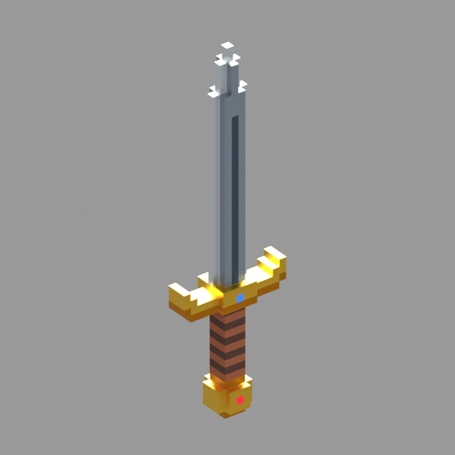
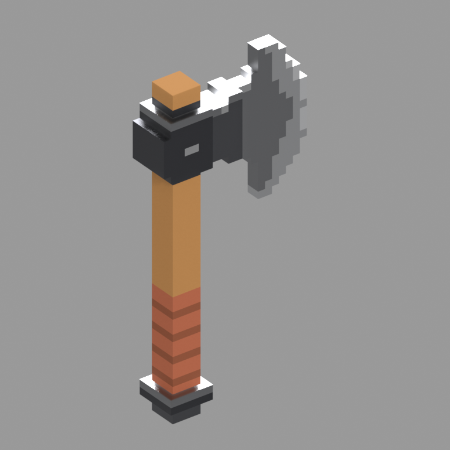
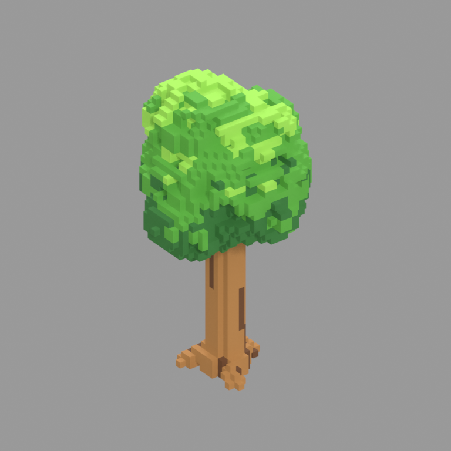
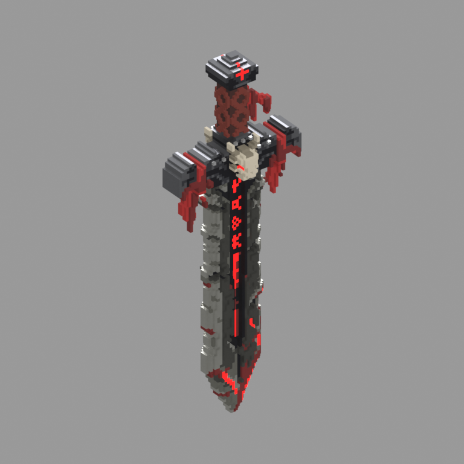
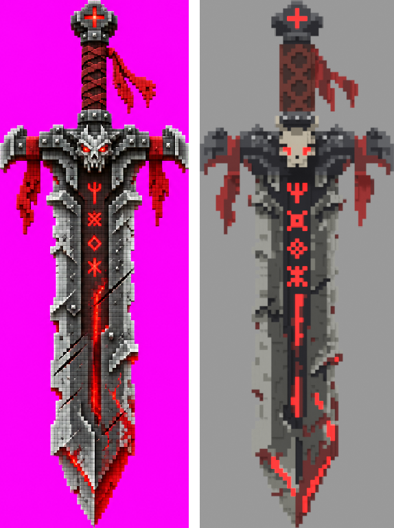

# VoxelStudio: voxel assets for Roblox, made by Claude

A [Claude Code](https://claude.com/claude-code) plugin that turns a reference image or a text prompt into a voxel-art 3D asset ready for Roblox Studio. Claude builds the model in Blender through the Blender MCP, checks its renders against the reference, fixes what doesn't match, and exports an optimized FBX with PBR palette maps.

| | | | |
|---|---|---|---|
|  |  |  |  |



## How it works
1. **Reference**: you send an image, or Codex generates a voxel-style reference (front and side views on a magenta background). Messy images (perspective, dark backgrounds, lighting) are redrawn cleanly first.
2. **Voxel grid**: a Python library (`voxelstudio`, numpy) builds the model as a grid of palette indices.
   - It offers shapes, masks, mirroring, 2D-to-3D extrusion, noise and named parts.
   - `image_to_layer` turns the reference into a palette-quantized front layer, with about 1 voxel per reference cube.
3. **Mesh**:
   - Face culling plus greedy meshing produce one optimized mesh, with no internal faces and no per-voxel objects.
   - Flat shading, one material and one tiny palette atlas.
   - Self-checks confirm the surface area, UVs and colors.
4. **Validation**: standard renders (front, side, 3/4, top, wireframe) plus side-by-side comparisons with the reference. Claude iterates until the asset matches; code that merely runs is not enough.
5. **Export**:
   - An FBX plus `color`, `metalness` and `roughness` atlases, which go into a Roblox `SurfaceAppearance`.
   - Glowing details become a separate mesh, to use as a Neon MeshPart.

| Asset | Voxels | Triangles |
|---|---|---|
| Sword | 626 | 376 |
| Axe | 1,372 | 456 |
| Tree | 7,121 | 4,742 |
| Dark sword (body + glow) | 18,315 | 11,874 |

## Install
In Claude Code:
```
/plugin marketplace add YuriPereira20/voxel-studio
/plugin install voxel-studio@voxel-studio
```
Or from a terminal: `claude plugin marketplace add YuriPereira20/voxel-studio && claude plugin install voxel-studio@voxel-studio`.

### Requirements
- **Blender 5.x** with the Blender MCP add-on connected to Claude Code. Its tools are named `mcp__Blender__*`; the plugin uses `execute_blender_code`. Blender's bundled Python already includes numpy.
- **Optional**, for generated references: the [Codex CLI](https://github.com/openai/codex) with the `image_generation` feature, plus PowerShell (Windows PowerShell 5.1 or `pwsh`).
- The exported FBX imports into Roblox Studio through the 3D Importer. Scale the asset there as needed.

## Usage
Open Claude Code in your game project, with Blender running, and ask:
- "crie uma espada voxel" or "make a voxel oak tree", or
- send an image with "make this a voxel asset".

The `voxel-asset` skill loads automatically.

**First use in a project:** the skill copies the default `voxel_config.json` (voxel size, a 50+ color palette, per-color metalness and roughness, limits, export rules) into your project. That file is your game's visual identity, and every asset in the project follows it. The palette is append-only.

**Output:** each asset lives in `voxel_assets/<name>/`:

| Path | What it holds |
|---|---|
| `build.py` | the script that builds the asset |
| `reference/` | the reference images |
| `renders/` | the standard renders and comparisons |
| `export/` | the FBX and the color, metalness and roughness PNGs |
| `<name>.blend` | the Blender file |

## Repository layout
- `plugin/`: the plugin (`skills/voxel-asset/` holds `SKILL.md`, the `voxelstudio/` library, the default config and `tools/gen_reference.ps1`).
- `.claude-plugin/marketplace.json`: the marketplace manifest.
- `voxel_assets/`: example assets. Use their `build.py` as templates. To run one yourself, set `LIB` and `PROJECT` at the top to your own paths.

## Português
Plugin do Claude Code que transforma uma imagem de referência (ou um pedido em texto) em um asset voxel para Roblox. O modelo é construído no Blender via MCP, validado visualmente contra a referência e exportado como FBX otimizado com mapas PBR. Instale com os comandos acima e peça "crie um X voxel" no seu projeto.

## License
[MIT](LICENSE)
